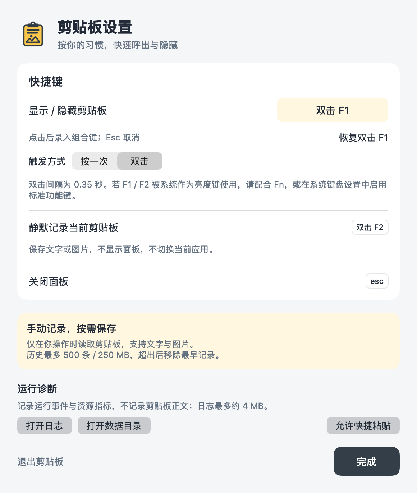
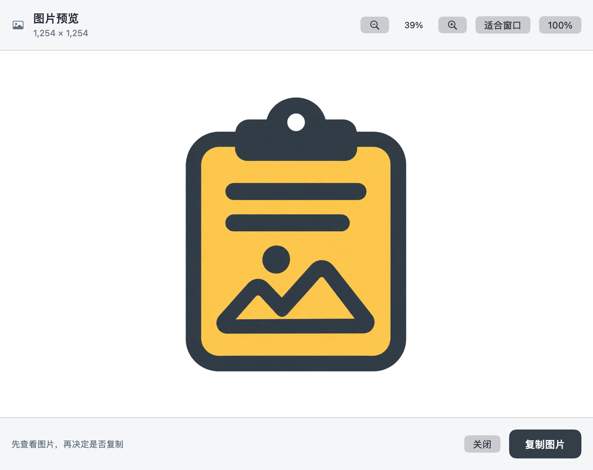
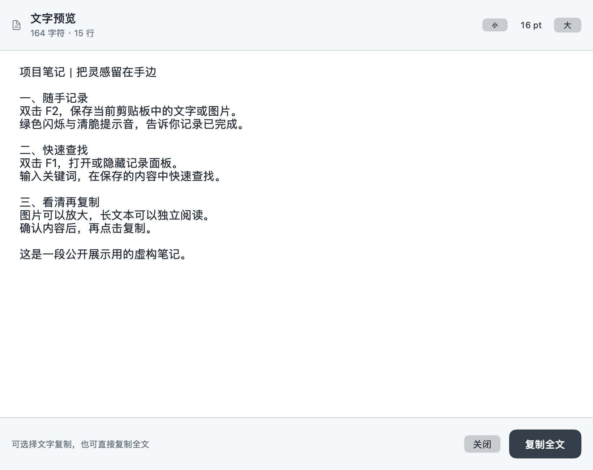

# 剪贴板 · ClipRecord

原生 macOS 菜单栏剪贴板记录器。SwiftUI 界面，AppKit 管理菜单栏、窗口与系统剪贴板，Bundle ID 为 `com.codemm.cliprecord`。


**双击 F1 呼出面板，双击 F2 静默记录。** 文字和图片按需保存，图片可放大，长文本可独立阅读。

## 下载安装

适用于 **macOS 14 及以上、Apple Silicon（M 系列）**。

- [下载 DMG 安装包](https://github.com/code-mm/macos-app-clip/releases/latest)：在 Assets 中选择 `ClipRecord-版本号-macOS-arm64.dmg`。
- 打开 DMG，将 **ClipRecord.app** 拖到 **Applications（应用程序）**，再从应用程序中启动。应用常驻菜单栏，不显示 Dock 图标。
- 更新前先退出旧版本，再替换应用；已有记录保留在用户资料库中。也提供 ZIP 和 `SHA256SUMS.txt` 供下载与校验。

GitHub Release 安装包使用 Developer ID 签名，目前**尚未经过 Apple 公证**。首次打开可能出现系统拦截；确认下载来源与校验值后，按 [Apple 官方说明](https://support.apple.com/zh-cn/102445) 在“系统设置 → 隐私与安全性”处理。本项目不要求关闭 Gatekeeper 或运行移除隔离属性的命令。

当前仓库为私有，下载需要登录有访问权限的 GitHub 账号。安装包不包含演示记录、个人剪贴板内容或运行日志。

## 界面展示

以下展示图均使用虚构文字和应用自有图标，不包含真实剪贴板、账号、聊天或桌面信息。上方为宣传合成图，下方由当前版本的原生 SwiftUI 界面渲染，点击可查看原图。

<table>
  <tr>
    <th>记录面板 · 收录与搜索</th>
    <th>快捷键与设置</th>
  </tr>
  <tr>
    <td width="50%" align="center"><a href="docs/media/main-panel.png"></a></td>
    <td width="50%" align="center"><a href="docs/media/settings.png"></a></td>
  </tr>
  <tr>
    <th>图片预览 · 放大后再复制</th>
    <th>长文本预览 · 完整阅读与复制</th>
  </tr>
  <tr>
    <td align="center"><a href="docs/media/image-preview.png"></a></td>
    <td align="center"><a href="docs/media/text-preview.png"></a></td>
  </tr>
</table>

图片来源与重新生成方法见 [展示素材说明](docs/media/README.md)。

## 运行

要求 macOS 14 或更新版本。当前构建产物为 Apple Silicon（arm64）。

```sh
./scripts/build-app.sh release
open build/ClipRecord.app
```

也可使用 Xcode 打开 `Package.swift` 阅读和开发；可双击的应用包由构建脚本组装。无需外部 Swift Package 依赖。

此开发脚本默认使用本地 ad-hoc 签名。发布打包脚本为 `scripts/package-release.sh`，可通过 `SIGNING_IDENTITY` 指定 Developer ID 证书；下载版的签名与验证状态见对应 Release 说明。

## 使用

- 点击菜单栏剪贴板图标打开面板。默认 **双击 F1** 显示／隐藏，间隔不超过 0.35 秒；长按不触发双击。
- 双击 F1 仅开关面板，不自动粘贴、不改写系统剪贴板。短文本点击或回车粘贴；长文本和图片点击或回车先预览。
- **双击 F2** 静默保存当前剪贴板的文字或图片，不打开面板、不切换当前应用、不执行粘贴，也不改写系统剪贴板。单击或长按不保存。
- F2 保存成功后，菜单栏图标变为亮绿色勾选并闪烁，同时以应用内最高音量播放一次清脆的系统 Ping 提示音；约 1.1 秒后恢复原图标。重复内容更新成功同样提示。失败时显示橙色警示图标并播放不同提示音，面板仍不弹出。不修改系统音量；系统静音时声音可能听不到，图标反馈仍生效。
- 部分键盘默认把 F1 / F2 当亮度键，需要配合 Fn，或在 macOS 设置中启用标准功能键。本程序不修改系统键盘设置。
- 顶部是粘贴记录区：点击“粘贴记录”、在粘贴区按 `⌘V` 或双击 F2 时读取并保存当前剪贴板。打开面板本身不读取剪贴板，不自动轮询或记录。F2 保存结果通过菜单栏图标与提示音反馈，并写入诊断日志，不弹出面板。
- 支持文字、剪贴板图片、拖入单张图片和“选择图片”。粘贴区支持拖入文字；在搜索框内 `⌘V` 仍然只粘贴搜索词。
- 图片文件支持 PNG、JPEG、TIFF、HEIC、GIF、BMP；PNG/TIFF 保留原字节，其他格式转为静态 PNG（GIF 取首帧），仍受原有大小和像素限制。富文本保存为纯文本；不支持通用文件记录。
- 图片缩略图或图片行点击后打开独立预览窗口，支持适合窗口、100%、放大／缩小和滚动；点击“复制图片”才复制原始图片。仅查看不会改写剪贴板。
- 长文本点击后打开独立大窗口，按原始纯文本展示完整内容，保留换行和缩进，可滚动、选择文字、调整字号（12–32 pt）及复制全文。多行、超过 80 字符或列表摘要已截断的文字先预览；其他短文本保留快速粘贴。
- 上下键选择；Enter 对短文本执行粘贴，对长文本和图片打开预览。预览可用 Esc 或关闭按钮退出。双击 F1 隐藏面板时一并关闭预览。右键记录可删除。
- 快捷粘贴需要辅助功能权限。没有权限时只复制，并明确提示用户按 ⌘V；可在设置点“允许快捷粘贴”自主授权。发出粘贴前会校验前一个应用已成功激活。
- 点击设置可修改面板快捷键，并选择按一次／双击。普通字符必须配合 Command / Option / Control；功能键可独立使用。无修饰键的 F2 保留给静默记录。注册失败保留原快捷键，并显示错误。
- 面板根据记录数量、搜索结果与提示信息调整高度，到当前显示器可用高度后列表滚动。为避免跨应用复制时误关闭，面板通过快捷键、Esc 或菜单栏按钮隐藏，不因外部鼠标点击自动关闭。

## 长期运行策略

- 没有剪贴板轮询、网络请求和全局键盘事件扫描。系统注册两个 Carbon 热键：面板开关和 F2 静默记录；两者各自独立判定双击。
- 历史最多 500 条且载荷总计不超过 250 MB，超出后移除最早记录。同种类型、相同字节去重并移至顶部。
- 文字单条最多 2 MB，图片最多 20 MB 且不超过 4000 万像素。图片首先检查元信息，原件落磁盘，不保留在模型内存中。
- 列表采用 `LazyVStack`，图片通过 Image I/O 下采样为最长边 240 px。缩略图缓存上限 12 MB / 80 项；隐藏面板、收到内存压力时清空缓存，离屏行释放其图片引用。
- 同时只保留一个大图预览；后台解码限制在最长边 4096 px / 800 万像素内，约不超过 32 MB RGBA 像素数据（不含框架和解码过程额外开销）。关闭时释放预览引用，已关闭窗口不会接收迟到的解码结果。复制仍使用完整原文件字节。
- 图片和长文本共用单个预览窗口。长文本只在打开时从磁盘读取，后台完成 UTF-8 解码与字符／行数统计；原生只读 NSTextView 保持选择、换行和滚动，关闭后清空文本和视图引用。
- 面板隐藏后销毁窗口与 SwiftUI 视图，释放局部键盘监听。没有全局鼠标监听。
- F2 的反馈仅在保存结果产生后运行一次短任务；重复触发取消前次闪烁，结束、系统睡眠或应用退出时恢复原图标。提示音按需加载并复用，不增加空闲轮询。
- 索引原子写入，成功提交索引后才清理淘汰载荷。损坏索引保留原始数据、禁止继续覆盖。
- 日志使用串行 actor 写入，每个文件最多 1 MB，保留当前文件及 3 个备份。记录启动／退出、保存／删除／粘贴结果、窗口开关及尺寸、异常类别。
- 启动约一分钟后采样，之后每 5 分钟采样一次，允许 30 秒定时器合并。指标包括 RSS、区间 CPU、记录数、存储量及运行时间。剪贴板文字、图片内容、搜索词、目标应用名称不写日志。

## 数据位置

```text
~/Library/Application Support/com.codemm.cliprecord/
  index.json
  items/<UUID>.txt|png|tiff

~/Library/Logs/com.codemm.cliprecord/
  runtime.jsonl
  runtime.1.jsonl ... runtime.3.jsonl
```

快捷键保存在本机 UserDefaults。设置提供“打开日志”和“打开数据目录”。无云同步、遥测上传。

## 验证

```sh
./scripts/test.sh
```

35 项 XCTest 覆盖 F2 保存提交后成功反馈、失败不误报成功、重复触发与闪烁恢复、粘贴／图片文件导入、格式转换、不支持文件拒绝、双击与长按防重、F1/F2 独立判定、静默保存、图片／长文本点击与回车先预览、完整原文／换行／缩进、明确操作才复制、原始字节保持、关闭后释放及忽略迟到解码、大图像素预算、存储恢复／删除／去重、条数和字节上限、损坏索引保护、窗口高度约束、图片下采样和日志轮转。剪贴板测试使用独立命名剪贴板，提示音通过注入模拟，不读写用户当前剪贴板、不播放测试音；压力用例连续写入 650 条并校验只保留 500 条及对应文件。

隔离的 UI 检查可以运行：

```sh
python3 scripts/make-review-fixture.py
open build/ClipRecord.app --args --data-directory "$PWD/build/review-fixture" --show
# 或打开设置：将 --show 换成 --settings
```

`--data-directory` 仅用于显式隔离测试数据，同时使用独立 QA 偏好域，不带参数则使用正常数据目录。不要用真实生产数据运行生成测试数据的脚本。

当前验收结论见 `docs/verification.md`。用户已实测确认双击 F1 显示／隐藏正常。短时测试不能证明数小时或数天驻留没有泄漏；不同 Fn 模式、唤醒后热键、多屏幕以及辅助功能授权后跨应用粘贴应继续人工验收。

## 设计与 API 依据

视觉沿用 `docs/design/gray-yellow-v2` 的灰黄系列，第 1 版紧凑列表结构。原生控件使用 SF Symbols；应用图标来自已确认方向的透明素材。

- [Apple NSPasteboard](https://developer.apple.com/documentation/AppKit/NSPasteboard)
- [Apple Image I/O 下采样](https://developer.apple.com/library/archive/documentation/GraphicsImaging/Conceptual/ImageIOGuide/imageio_source/ikpg_source.html)
- Carbon 热键接口声明以当前 Xcode SDK `HIToolbox/CarbonEvents.h` 为依据。
